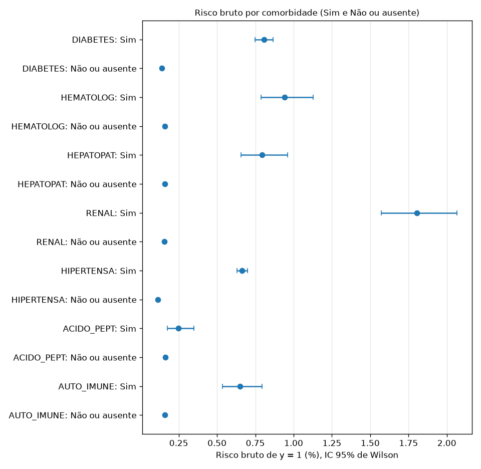
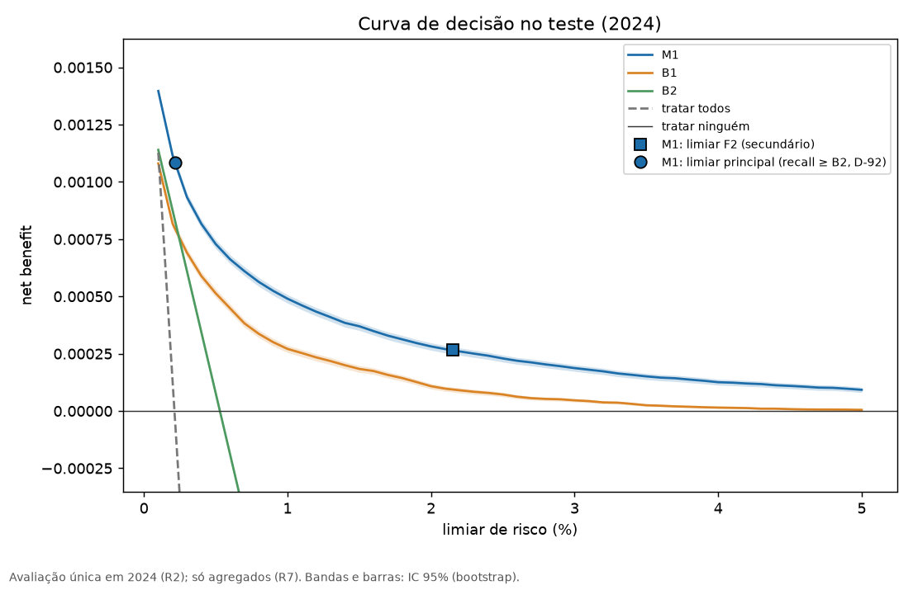
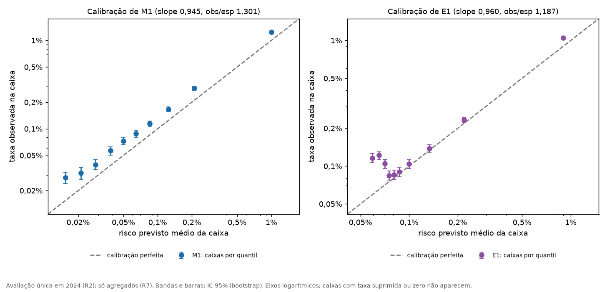
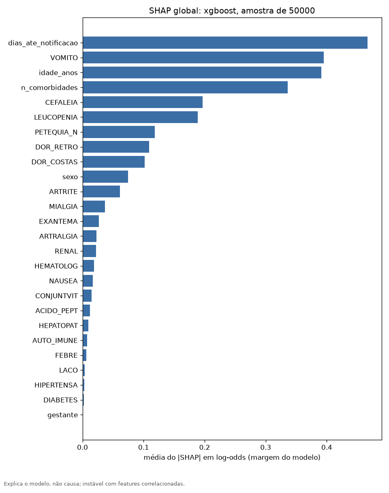
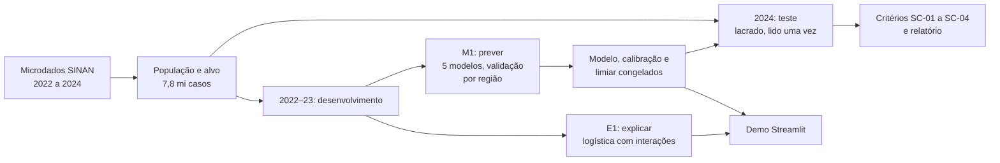

# Risco de dengue grave ou óbito por comorbidades

Projeto acadêmico de aprendizado de máquina com os microdados públicos do SINAN (DataSUS), de 2022 a
2024. Ele responde a duas perguntas: **quais comorbidades estão associadas a maior risco de dengue
grave ou morte** e **se um modelo prevê esse risco, no primeiro atendimento, melhor que a regra que o
Ministério da Saúde já usa**.

> **Projeto acadêmico. Não é ferramenta clínica nem substitui avaliação médica.** Os resultados são
> associações estatísticas, não causas.

**Atalhos:** [em linguagem simples](#em-linguagem-simples) ·
[resultados](#resultados-do-teste-de-2024) · [como foi feito](#como-foi-feito) ·
[limitações](#o-que-não-deu-certo-e-os-limites) · [rodar a demo](#demo-streamlit) ·
[relatório completo](reports/relatorio/relatorio.md)

---

## Em linguagem simples

Na dengue, quase todo mundo melhora sozinho. Só uma pequena parte dos casos vira a forma grave ou leva
à morte: **cerca de 1 em cada 470 a 630 casos confirmados**, conforme o ano. Em uma epidemia, os
serviços de saúde recebem mais pacientes do que conseguem acompanhar de perto e precisam decidir quem
priorizar.

O projeto usou os dados de **7,8 milhões de casos confirmados** para perguntar:

1. **Quem tem mais risco?** Doenças do sangue, dos rins, autoimunes e do fígado se associam a um risco
   várias vezes maior. Diabetes e hipertensão também, em menor grau.
2. **Dá para prever?** Um modelo de computador ordena os casos por risco bem melhor que o acaso e que
   um modelo simples, e aponta menos casos para atenção do que a regra do Ministério da Saúde. Mas
   **não encontrou tantos casos graves quanto a regra** (por menos de 1 ponto percentual), e esse
   resultado foi registrado como falha do critério combinado antes do teste.

O ponto mais importante: o modelo **não é um teste de diagnóstico**. Dos casos que ele aponta como de
maior risco, cerca de 99% não ficam graves. Ele serve para pensar em grupos e em priorização, e não
para dizer o que vai acontecer com uma pessoa.

---

## Resultados do teste de 2024

O ano de 2024 (5,3 milhões de casos, 11.338 graves ou óbitos, uma epidemia grande) foi guardado,
**lido uma única vez** e só depois que modelo, limiar e critérios estavam congelados.

| Modelo | PR-AUC<br>(quanto maior, melhor) | O que é |
|---|---|---|
| B0 | 0,0021 | Dá a mesma probabilidade para todos. É o piso. |
| B1 | 0,0166 | Regressão logística simples, só com idade e comorbidades. |
| E1 | 0,0220 | Regressão logística com interações, feita para explicar. |
| **M1 (XGBoost)** | **0,0346** | O modelo de predição escolhido, cerca de 16 vezes a prevalência. |

Critérios de sucesso definidos antes do teste:

| Critério | Resultado | |
|---|---|---|
| **SC-01** M1 supera o B0 em PR-AUC | diferença de 0,0325 (IC 95%: 0,0303 a 0,0350) | passou |
| **SC-02** M1 encontra ao menos tantos casos graves quanto a regra do Ministério (B2), com precisão maior | recall 65,3% contra 66,0%, diferença de −0,7 ponto percentual (IC: −1,5 a +0,05); precisão 0,98% contra 0,53% | **falhou** |
| **SC-03** calibração (slope) entre 0,8 e 1,2 | 0,945 | passou |
| **SC-04** diferença do M1 para o B1 reportada | M1 acima por 0,0181 (IC: 0,0163 a 0,0201) | passou |

**Contra a regra do protocolo:** o M1 apontou 759 mil casos contra 1,41 milhão da regra (46% menos),
capturando 7.402 dos 11.338 eventos contra 7.484. A precisão é quase o dobro, mas o recall ficou um
pouco abaixo, e por isso o SC-02 falhou. O IC da diferença mal inclui zero (limite superior de +0,05
ponto percentual), então os dados quase, mas não totalmente, separam os dois.

**Deriva em 2024:** o modelo **subestimou o risco**. Houve cerca de 30% mais casos graves do que o
previsto (observado/esperado de 1,30), porque 2024 foi um ano de epidemia, mais intenso que os anos de
treino.

### Gráficos

**1. Risco bruto por comorbidade (2022–23).** Quem tem cada condição (Sim) tem risco maior que quem não
tem; a doença renal é a mais extrema.



**2. Razões de chances do modelo E1** (ajustadas por idade e sexo, comorbidade isolada):

| Comorbidade | Razão de chances (IC 95%) |
|---|---|
| Doença hematológica | 9,32 (7,27 a 11,95) |
| Doença renal | 6,80 (5,07 a 9,12) |
| Doença autoimune | 5,02 (3,78 a 6,68) |
| Hepatopatia | 4,89 (3,58 a 6,68) |
| Diabetes (aos 40 anos) | 2,98 (2,30 a 3,86) |
| Hipertensão (aos 40 anos) | 2,67 (2,24 a 3,20) |
| Úlcera péptica | 0,70 (0,42 a 1,17), o IC inclui 1: sem evidência de efeito |

Duas comorbidades juntas somam menos do que o produto dos efeitos isolados (9 das 15 interações têm IC
inteiro abaixo de 1). Isso não quer dizer que ter as duas protege: o risco continua bem maior que o de
quem não tem nenhuma.

**3. Utilidade da decisão (curva de decisão, 2024).** O benefício líquido do M1 fica acima do B1 e da
regra B2 em quase toda a faixa de limiares de 0,1% a 5%.



**4. Calibração (2024).** Os pontos acima da linha tracejada mostram a subestimação: o risco observado
foi maior que o previsto.



**5. O que mais pesa no modelo (SHAP global).** Dias até a notificação, vômito, idade e número de
comorbidades. É contribuição no modelo, **não causa**.



---

## Como foi feito



- **Alvo:** o caso confirmado evoluiu para dengue grave (classificação final 12) ou morreu pelo agravo.
  Só entram variáveis que existem no primeiro atendimento: idade, sexo, gestação, 7 comorbidades,
  sintomas iniciais e dias entre os sintomas e a notificação. Exames, hospitalização e a evolução do
  caso ficam de fora, porque revelariam o desfecho (vazamento).
- **Divisão temporal:** treino e escolha de modelo em 2022–23; teste em 2024. Dentro do
  desenvolvimento, a validação cruzada **deixa uma região do país de fora por vez**, para medir se o
  modelo funciona em outro lugar.
- **Cinco candidatos:** regressão logística com penalização (elastic net), XGBoost, CatBoost, rede
  neural (MLP) e floresta aleatória, todos com as mesmas linhas, as mesmas dobras e a mesma semente.
  **Venceu o XGBoost**, escolhido pela PR-AUC fora da dobra, que é a métrica adequada para um desfecho
  raro.
- **Sem correção artificial de desbalanceamento:** o modelo treina com a prevalência real e entrega
  probabilidades calibradas. O recall é controlado pelo limiar.
- **O limiar** foi escolhido nas predições fora da dobra de 2022–23, como o de maior precisão entre os
  que igualam o recall da regra do protocolo.
- **Baselines:** B0 (todos iguais), B1 (logística simples) e B2 (a regra do grupo B do protocolo do
  Ministério da Saúde, traduzida para os campos da ficha).
- **Disciplina de pesquisa:** o teste é lacrado (`reports/teste/LACRE.json`) e uma segunda execução
  falha; os critérios foram fixados antes; nada foi ajustado depois de ver o resultado. A reprodução da
  avaliação, feita num clone limpo, regerou os 14 arquivos de resultado idênticos byte a byte.
- **Rastreabilidade:** cada decisão tem um registro (D-01 a D-96) em
  [`specs/research.md`](specs/research.md), e cada passo, um teste. São mais de 1.400 testes
  automatizados, e o ambiente é travado em `uv.lock`.

---

## O que não deu certo e os limites

- **O SC-02 falhou.** Foi uma falha pequena, mas é uma falha. O limiar foi escolhido, por desenho
  (D-92, "sem folga"), na borda do recall da regra: nas predições fora da dobra de 2022–23 o recall do
  M1 era 0,6846 contra 0,6843 da regra. O critério também não tinha margem de tolerância. Em 2024 o
  recall caiu nos dois, mais no M1 (0,6528 contra 0,6601), e o M1 ficou abaixo. Atribuir isso à deriva
  é uma interpretação; o teste não separa a deriva do acaso.
- **O risco foi subestimado em 2024** (observado/esperado de 1,30), e a precisão é baixa em termos
  absolutos (cerca de 99% dos casos apontados não ficam graves).
- **A regra B2 é uma versão parcial do protocolo**, porque a ficha não tem asma, DPOC nem obesidade.
- **Dados administrativos:** duplicatas prováveis não foram removidas; o campo `TP_SISTEMA` difere
  entre estados (o Espírito Santo usa outro sistema); "não" em leucopenia pode significar "não foi
  feito". `NDUPLIC_N` e `TP_SISTEMA` não constam no dicionário oficial, então o significado dos códigos
  não tem fonte.
- **Não houve revisão por profissional de saúde**, e não há uso clínico previsto.
- **O teste usou um só ano.** Os dados finais de 2025 existem (1,39 milhão de casos, 3.436 eventos;
  [`reports/perfil_2025.md`](reports/perfil_2025.md)) e não foram usados. Validar em um segundo ano fica
  como trabalho futuro.

---

## Demo (Streamlit)

> **Projeto acadêmico. Não é ferramenta clínica nem substitui avaliação médica.**

Duas abas: **Perfil** (modelo explicativo E1: o risco de quem tem certas condições) e **Triagem**
(modelo preditivo M1: o risco de um paciente, com sintomas, agora).

Seletor no topo: **Normal** (padrão, linguagem simples, sem termos técnicos nem o rótulo "alto risco")
e **Pro** (IC, razões de chances, fatores em log-odds, limiar e regra B2).

**Instalar e rodar**

```
uv sync
uv run streamlit run src/app/streamlit_app.py
```

**Onde ficam os artefatos**

| Variável | Conteúdo | Padrão |
|---|---|---|
| `DENGUE_MODELOS` | pasta com `e1/` e `m1_final/` (ou `m1_demo/`) | `models/` (do `config/base.yaml`) |
| `DENGUE_RELATORIOS` | pasta com `teste/metricas.json`, que alimenta o painel do teste | `reports/` |

- `models/e1` está no git.
- `models/m1_final` **não está no git** (R7, D-85). Para obtê-lo, reproduza a T-4.10 ou pegue-o no
  Drive do projeto. O SHA-256 do payload (`payload/m1.joblib`) é
  `394c0f19e9384dc41e4e13b872a29ac8b8fb9de1d0f0413ba5c72321d0e9901a`. Sem ele, só a aba Perfil
  funciona, e a aba Triagem mostra uma mensagem.
- Sem `reports/teste/metricas.json`, o painel do teste simplesmente não aparece.
- O XGBoost deve ser o 3.4.1 do `uv.lock`. O `m1_final` foi gravado com o booster em GPU e, sem GPU, a
  leitura completa falha; o app tem um contorno que lê só as árvores. A paridade com a carga normal foi
  provada por hash do dump das árvores e por predições
  (`reports/verificacao/paridade-m1-demo.json`).

**Privacidade:** a demo não grava, não registra em log nem envia as entradas, não tem analytics e não
embarca microdados.

---

## Estrutura e documentação

| Onde | O quê |
|---|---|
| [`src/dengue_sinan/`](src/dengue_sinan) | Pipeline: download, população, divisão, modelos, avaliação |
| [`src/app/`](src/app) | Demo Streamlit (entrada, serviço, textos dos modos, tela) |
| [`tests/`](tests) | Testes automatizados |
| [`config/`](config) | Configuração (semente única, anos, caminhos) |
| [`reports/`](reports) | Resultados em agregados (nenhum microdado): descritiva, E1, M1, SHAP, teste |
| [`reports/relatorio/relatorio.md`](reports/relatorio/relatorio.md) | **Relatório completo** (TRIPOD+AI), com versão em Word |
| [`specs/`](specs) | Especificação, plano, decisões e tarefas (convenções do GitHub Spec Kit) |
| [`specs/goal.md`](specs/goal.md) | Ponto de entrada: objetivo e mapa dos artefatos |
| [`specs/quickstart.md`](specs/quickstart.md) | Como rodar o ambiente local e o Colab |

**Dados:** [Sinan/Dengue](https://dadosabertos.saude.gov.br/dataset/arboviroses-dengue) do Ministério da
Saúde (DataSUS), dados públicos e desidentificados. Os microdados **não** são redistribuídos aqui:
`data/` e os arquivos de dados ficam fora do git, e o repositório só tem agregados.

**Testes e lint:**

```
uv run pytest -q
uv run ruff check .
```

A suíte completa leva cerca de 30 minutos.
