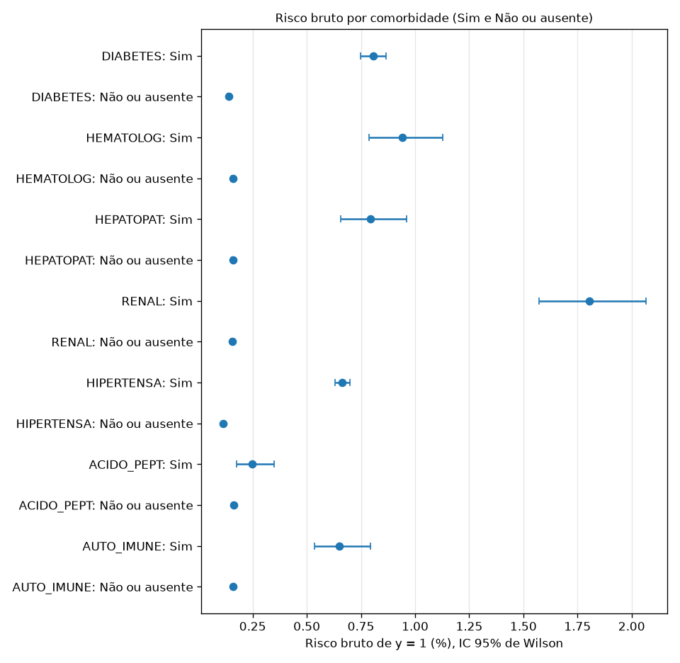
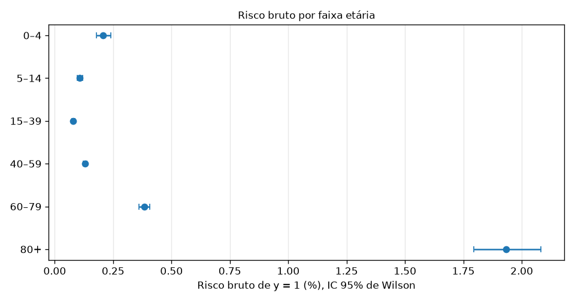
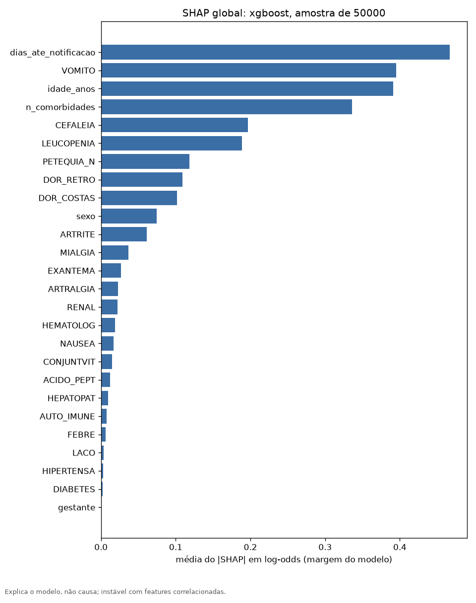
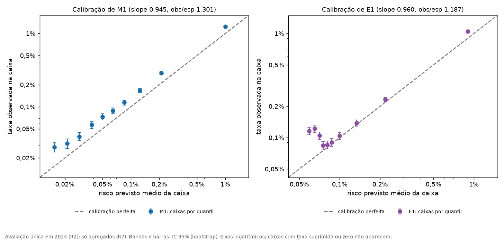
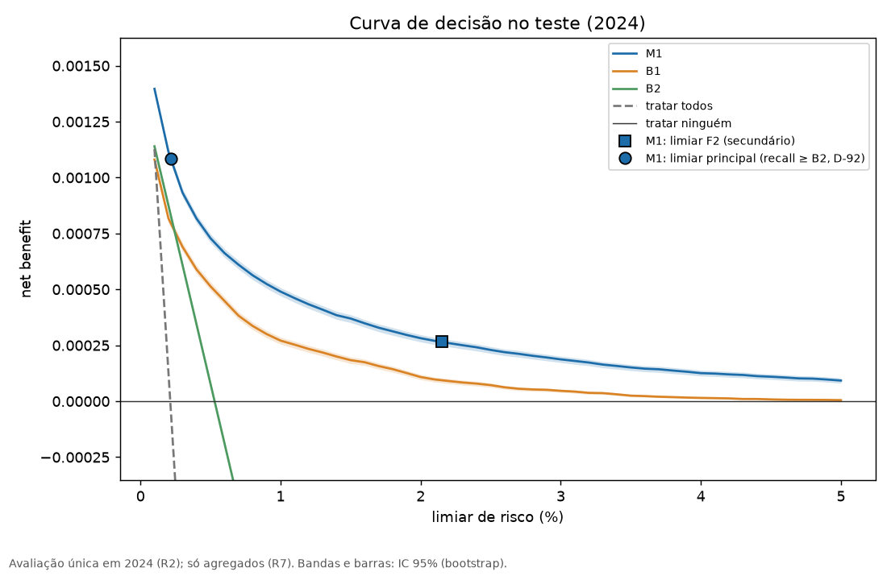
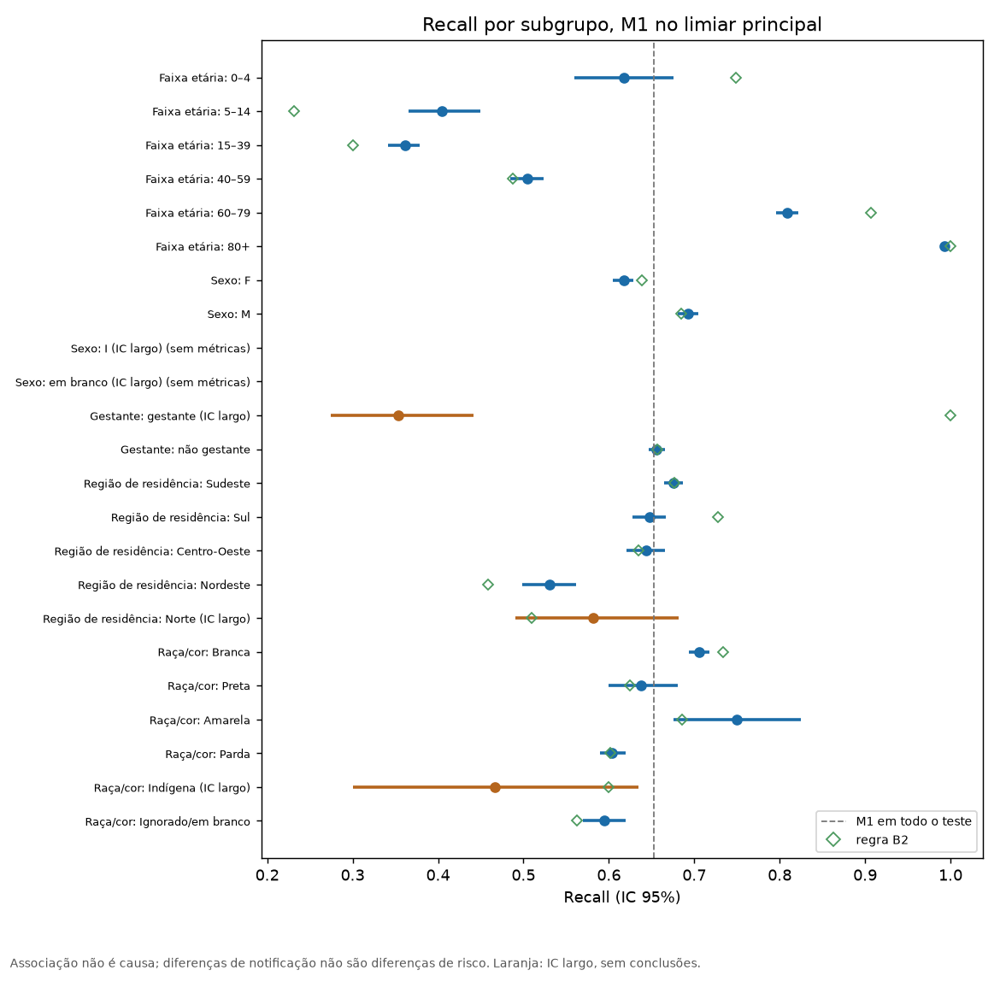

<!--
Relatório acadêmico do projeto dengue-comorbidity-risk (Marco 7, T-7.1).
Rascunho em Markdown, para conversão em documento Word no padrão ABNT.
Todos os números vêm de arquivos de reports/ ou de specs/; cada tabela e figura indica a fonte.
Caminhos de figura são relativos a reports/relatorio/.
-->

# ELEMENTOS PRÉ-TEXTUAIS

## Capa

[PREENCHER: nome da instituição]

[PREENCHER: curso]

[PREENCHER: nome(s) do(s) autor(es)]

**RISCO DE DENGUE GRAVE OU ÓBITO POR PERFIL DE COMORBIDADES: ASSOCIAÇÃO E PREDIÇÃO COM DADOS DO SINAN, BRASIL, 2022–2024**

[PREENCHER: cidade]

[PREENCHER: ano]

## Folha de rosto

[PREENCHER: nome(s) do(s) autor(es)]

**RISCO DE DENGUE GRAVE OU ÓBITO POR PERFIL DE COMORBIDADES: ASSOCIAÇÃO E PREDIÇÃO COM DADOS DO SINAN, BRASIL, 2022–2024**

Trabalho apresentado à disciplina [PREENCHER: nome da disciplina] do curso de [PREENCHER: curso] da [PREENCHER: instituição], como requisito parcial para [PREENCHER: finalidade/avaliação].

Professor(a): [PREENCHER: nome do(a) professor(a)]

[PREENCHER: cidade]

[PREENCHER: ano]

## Resumo

A dengue grave e o óbito pelo agravo são raros, mas concentram o custo de uma epidemia. Este trabalho usa os microdados públicos do SINAN (DataSUS) de 2022 a 2024 para responder a duas perguntas: quais comorbidades e combinações estão associadas a maior risco de dengue grave ou óbito, e se um modelo de aprendizado de máquina estima esse risco, no primeiro atendimento, melhor que a regra do protocolo do Ministério da Saúde. A população tem 7.784.953 casos confirmados e 15.323 eventos (prevalência de 0,16% a 0,21%). Uma regressão logística com interações, ajustada por idade e sexo em 2022–23, mostrou as maiores razões de chances para doença hematológica (9,32), doença renal (6,80) e doença autoimune (5,02). Cinco modelos preditivos foram comparados por validação cruzada que deixa uma região de fora por vez; venceu o XGBoost. No teste único em 2024, ele obteve PR-AUC de 0,0346, cerca de 16 vezes a prevalência, e superou a logística simples. Contra a regra do protocolo, marcou 46% menos casos com recall próximo (65,3% contra 66,0%), mas não alcançou o recall da regra, e o critério de sucesso correspondente falhou. O modelo subestimou o risco em 2024 (razão observado/esperado de 1,30). Os resultados são associações, não causas, e o modelo não é ferramenta clínica.

**Palavras-chave:** dengue grave; comorbidades; aprendizado de máquina; predição de risco; SINAN.

## Abstract

Severe dengue and dengue death are rare, but they concentrate the burden of an epidemic. This work uses public SINAN (DataSUS) microdata from 2022 to 2024 to answer two questions: which comorbidities and combinations are associated with a higher risk of severe dengue or death, and whether a machine learning model estimates this risk, at the first visit, better than the Brazilian Ministry of Health protocol rule. The population has 7,784,953 confirmed cases and 15,323 events (prevalence of 0.16% to 0.21%). A logistic regression with interactions, adjusted for age and sex in 2022–23, showed the largest odds ratios for hematologic disease (9.32), kidney disease (6.80) and autoimmune disease (5.02). Five predictive models were compared with cross-validation that leaves one region out at a time; XGBoost won. In the single test on 2024 data, it reached a PR-AUC of 0.0346, about 16 times the prevalence, and outperformed the simple logistic regression. Against the protocol rule, it flagged 46% fewer cases with similar recall (65.3% versus 66.0%), but it did not reach the rule's recall, and the corresponding success criterion failed. The model underestimated risk in 2024 (observed/expected ratio of 1.30). The results are associations, not causes, and the model is not a clinical tool.

**Keywords:** severe dengue; comorbidities; machine learning; risk prediction; SINAN.

## Sumário

[SUMÁRIO AUTOMÁTICO]

<!-- Listas de ilustrações e de tabelas: opcionais na ABNT; gerar automaticamente no Word se desejado. -->

---

# 1 INTRODUÇÃO

> **Em uma frase:** em epidemias de dengue, saber quem tem mais chance de piorar ajuda a priorizar o cuidado, e este projeto mede quanto as comorbidades contribuem para esse risco e se um modelo de aprendizado de máquina acrescenta algo à regra que o Ministério da Saúde já usa.

## 1.1 O problema

Em epidemias, como a de 2024, os serviços recebem muito mais pacientes com dengue do que conseguem acompanhar de perto, e é preciso priorizar quem volta em 24 a 48 horas ou fica em observação.

Hoje essa decisão segue o protocolo do Ministério da Saúde (*Dengue: diagnóstico e manejo clínico, adulto e criança*, 6ª ed.; Brasil, 2024). O grupo de manejo B reúne quem não tem sinais de alarme, mas tem sangramento de pele (espontâneo ou na prova do laço) ou uma condição especial. A prova do laço é um teste em que se aperta o braço com o manguito do aparelho de pressão para ver se surgem pequenos pontos de sangramento na pele. As condições especiais incluem lactentes, gestantes, maiores de 65 anos, hipertensão, diabetes, doença renal crônica e outras comorbidades.

O desfecho é raro: entre os casos confirmados de 2022 a 2024, cerca de 1 em cada 470 a 630 evolui para dengue grave ou óbito, conforme o ano; em 2022–23, cerca de 1 em cada 616 (3.985 eventos em 2.453.208 casos). Um modelo que diz "ninguém vai piorar" acerta mais de 99% das vezes e não serve para nada.

## 1.2 As duas perguntas do projeto

- **Explicar (foco principal).** Quais comorbidades e combinações estão associadas a maior risco de dengue grave ou óbito, levando em conta idade e sexo? É uma pergunta de **inferência**, respondida por regressão logística com interações e tabelas de risco por perfil.
- **Prever (foco secundário).** Qual a probabilidade de um paciente, no primeiro atendimento, evoluir para dengue grave ou óbito? É uma pergunta de **predição**. O aprendizado de máquina só se justifica se superar a regra do protocolo e uma logística simples; se não superar, isso é um resultado válido.

## 1.3 Trabalhos relacionados

O trabalho mais próximo é o de Rosa, Tavares e Recamonde-Mendoza (2026): SINAN nacional, sem exames, Random Forest e as mesmas 7 comorbidades, com hipertensão, diabetes e doença renal entre os preditores mais fortes. A comparação tem limites: a classe de baixo risco veio só de 2021 e as demais de 2014 a 2025 (a classe se confunde com o ano), não houve calibração e não houve validação externa.

Huang et al. (2020) usaram exames do primeiro dia num único hospital de Taiwan, sem comorbidades.

As meta-análises de Sangkaew et al. (2021), Tsheten et al. (2021) e Chagas et al. (2022) apontam diabetes, hipertensão e doença renal como fatores de risco. Em geral, elas usam razões de chances brutas, sem ajuste por idade, e olham cada comorbidade isolada `[VERIFY: meta-análises lidas só no resumo; ver research.md]`. Trindade et al. (2024), um resumo de congresso, chega a conclusão parecida a partir de 5 artigos.

Na literatura de predição em dengue, a validação externa é rara e o risco de viés é alto (Delpino et al., 2026; Diaz-Arocutipa; Chumbiauca; Soto-Becerra, 2025).

## 1.4 O diferencial deste projeto

As comorbidades já aparecem em trabalhos anteriores. O diferencial (D-25) está em: **combinações** de comorbidades com intervalo de confiança; **risco absoluto calibrado por perfil**; **comparação com a regra do protocolo**; e **validação externa temporal (2024) e geográfica (por região)**, com a prevalência natural.

---

# 2 MÉTODOS

> **Em uma frase:** os dados são os casos confirmados de dengue do SINAN de 2022 a 2024; os modelos foram construídos só com 2022–23, comparados deixando uma região de fora por vez, e testados uma única vez em 2024.

## 2.1 Fonte de dados e população

**Fonte.** Microdados públicos do SINAN Dengue, do FTP oficial do DataSUS, com o hash SHA-256 de cada arquivo registrado. A licença é Creative Commons Atribuição-SemDerivações 3.0; o projeto cita a fonte e não redistribui os microdados.

**Unidade e inclusão.** Cada notificação de caso confirmado é uma unidade. Entram os casos com classificação final dengue (código 10), dengue com sinais de alarme (11) ou dengue grave (12). Os casos 12 entram com qualquer evolução, porque o desfecho já é conhecido (D-45); os casos 10 e 11 exigem evolução "cura" ou "óbito pelo agravo". Quando o código de idade é inválido, usa-se o ano dos sintomas menos o ano de nascimento (D-50).

**Tabela 1 – Fluxograma de exclusão por ano do arquivo**

| Etapa | 2022 | 2023 | 2024 |
|---|---:|---:|---:|
| 1. Notificações no arquivo | 1.405.095 | 1.645.956 | 6.564.924 |
| 2. Classificação final 10, 11 ou 12 | 1.254.238 | 1.426.773 | 6.014.359 |
| 3. Rótulo conhecido | 1.148.338 | 1.304.949 | 5.331.924 |
| 4. Idade válida (população final) | 1.148.299 | 1.304.909 | 5.331.745 |
| Eventos (dengue grave ou óbito) | 1.869 | 2.116 | 11.338 |
| Prevalência | 0,16% | 0,16% | 0,21% |

Fonte: `reports/fluxograma.md` (2022 e 2023) e `specs/data-model.md`, seção "Tamanho e prevalência" (2024 e eventos). Motivos de exclusão no Apêndice B.

O desenvolvimento (2022–23) soma 2.453.208 casos e 3.985 eventos (Fonte: `specs/data-model.md`).

## 2.2 O desfecho (alvo)

**Definição.** O alvo vale 1 se a classificação final for dengue grave **ou** se a evolução for óbito pelo agravo (`CLASSI_FIN = 12` ou `EVOLUCAO = 2`); caso contrário, vale 0 (D-02). O Ministério da Saúde chama de "casos graves" a soma de dengue com sinais de alarme e dengue grave; o alvo deste projeto é mais estrito, e as taxas daqui não se comparam diretamente às oficiais.

**Por que o alvo difere do pré-projeto (D-22).** O pré-projeto entregue ao professor definia agravamento de forma ampla: hospitalização, sinais de alarme, dengue grave ou óbito. O projeto manteve o alvo estrito, por dois motivos. Primeiro, a **hospitalização é circular**: a decisão de internar depende da conduta médica, que já usa a comorbidade como critério (é o que define o grupo B do protocolo), e da disponibilidade de leitos. Parte da associação "comorbidade leva à hospitalização" mediria a conduta do médico, e não a evolução do paciente. Segundo, os **sinais de alarme são um estado intermediário**: indicam risco de progressão, mas não são o desfecho. Usar o alvo amplo faria o modelo aprender, em parte, o próprio protocolo que ele pretende avaliar.

O rótulo vem da classificação feita pela vigilância no encerramento do caso e tem ruído conhecido: subnotificação de casos leves, encerramento por critério clínico-epidemiológico e qualidade variável entre estados.

## 2.3 Preditores e vazamento de dados

**Vazamento de dados** é treinar com informação indisponível no momento da previsão ou quase igual ao rótulo, como um aluno que viu o gabarito. O momento da predição é o **primeiro atendimento** (M1, D-03), e as 121 colunas do arquivo foram revisadas. Entraram **26 variáveis**: idade, sexo, gestação, as 7 comorbidades da ficha e o número delas, 12 sintomas iniciais, leucopenia, prova do laço e os dias entre os sintomas e a notificação.

Ficaram **de fora**: resultados de exames (chegam dias depois); hospitalização (posterior e quase um desfecho); sinais de alarme, sinais de gravidade e campos da antiga classificação de febre hemorrágica (definem ou antecipam o rótulo); unidade de notificação (casos notificados por hospital tendem a ser mais graves); região e estado (D-21, incompatíveis com a validação por região); escolaridade, com 50% a 54% de ignorados, e raça/cor, que só é usada para avaliar equidade (D-48).

O **vazamento por completude** (fichas de casos graves mais preenchidas, tornando o campo em branco um sinal de "não grave") não se confirmou: comorbidade ausente é 0,00% nos casos sem o desfecho e 0,01% nos com o desfecho (Fonte: `specs/data-model.md`, seção "Ausência de dados").

## 2.4 Desenho de validação

**Camada temporal (D-08).** Todo o desenvolvimento usa só 2022 e 2023. O ano de 2024 é o **teste**, lido uma única vez, no fim, com o modelo congelado; um "lacre" gravado ao fim da avaliação impede uma segunda execução (regra R2).

**Camada geográfica (validação que deixa uma região de fora, ou *leave-one-region-out*).** Em 2022–23, os modelos foram comparados em 5 rodadas, chamadas dobras. Em cada uma, o modelo treina com 4 regiões e prevê a quinta, como uma receita aprendida em quatro cozinhas e testada numa quinta que o cozinheiro nunca viu. Esse desenho interno-externo é o recomendado em vez da divisão aleatória (Steyerberg; Harrell, 2016).

As previsões sobre a região deixada de fora se chamam **predições fora da dobra**. Elas serviram para escolher os hiperparâmetros (ajustes definidos antes do treino, como a profundidade das árvores), calibrar as probabilidades e fixar o limiar (FR-17). As dobras têm de 121 eventos (Norte) a 1.736 (Sudeste) e foram salvas com hash, para que todos os modelos usassem as mesmas linhas (Fonte: `reports/baselines.md`).

> **O que isso significa:** nenhum número do teste de 2024 influenciou qualquer escolha do modelo. Se o modelo for pior em 2024, isso é um resultado sobre a mudança do mundo entre os anos, e não um erro a corrigir.

## 2.5 Modelos

**Modelo explicativo (E1).** Regressão logística sem penalização com idade em spline (uma curva flexível, em vez de uma reta), sexo, gestação, as 7 comorbidades, as interações 2 a 2 entre comorbidades com pelo menos 10 eventos (15 dos 21 pares) e a interação da idade com hipertensão e diabetes. Usa só o perfil, sem sintomas, porque responde a "qual o risco de um hipertenso de 65 anos?" (D-20).

**Baselines.** **B0** prevê para todos a prevalência do treino; **B1** é uma logística com o perfil do E1, sem interações; **B2** é a regra do protocolo, que marca "alto risco" se o caso tem menos de 24 meses ou mais de 65 anos, é gestante, tem pelo menos uma das 7 comorbidades, prova do laço positiva ou petéquias. Asma, DPOC, obesidade e risco social ficaram fora da B2 porque a ficha não os registra.

**Candidatos do M1.** Cinco modelos receberam as mesmas 26 variáveis, dobras e semente, numa única sessão no Google Colab: **elastic net** (logística penalizada), **XGBoost** e **CatBoost** (árvores treinadas em sequência, cada uma corrigindo a anterior), **Random Forest** (média de árvores independentes) e **MLP** (rede neural simples). A busca de hiperparâmetros usou o Optuna, uma biblioteca que testa combinações automaticamente, com 20 a 40 minutos por modelo. A parada antecipada (interromper o treino quando o desempenho numa parte separada dos dados deixa de melhorar) usou uma validação interna de 10% de cada dobra, nunca a região deixada de fora (FR-22).

**TabFM, cortado do M1 (D-91).** O professor pediu também o TabFM, modelo tabular do Google que prevê sem treino, a partir de linhas de exemplo. Na GPU T4, 10.000 linhas de contexto estouraram a memória, e contextos menores projetavam de 11,9 h a 61 h só para as predições fora da dobra (Fonte: `specs/research.md`, D-91). O Programador decidiu tirá-lo do M1; sua qualidade não foi medida.

**Seleção.** Vence a maior PR-AUC média nas 5 dobras. A PR-AUC é a área sob a curva que relaciona precisão (fração dos casos marcados que de fato pioram) e recall (fração dos que pioram que o modelo marca); ela mede quão bem o modelo encontra os casos raros. Na seleção, se a diferença for menor que 0,005 ou os IC se sobrepuserem, desempata o menor Brier calibrado. O vencedor foi retreinado em todo 2022–23 (D-37).

## 2.6 Desbalanceamento de classes: por que não houve correção

Com cerca de 1 evento para cada 616 casos em 2022–23 (2.453.208 casos sobre 3.985 eventos), é comum "corrigir o desbalanceamento" com pesos de classe, descarte de casos comuns ou casos sintéticos (SMOTE). O projeto não fez nada disso (D-38, regra R3). Essas correções não melhoram a separação entre graves e não graves e **pioram a calibração**, inflando os riscos de um modo que a recalibração nem sempre conserta (van den Goorbergh et al., 2022; Carriero et al., 2025). Como o produto é um risco em porcentagem, a calibração vem antes; o equilíbrio entre encontrar casos e gerar alarmes fica com o limiar (seção 2.7). 

A única exceção prevista era uma subamostra de negativos no Random Forest, por falta de memória. Pela tabela da busca, o Random Forest rodou sem subamostra; só o elastic net usou subamostra, e ela foi estratificada pelo alvo, na busca de hiperparâmetros, mantendo a prevalência (Fonte: `reports/m1/comparacao_oof.md`, seção 4).

## 2.7 Métricas e limiar de decisão

As definições dos termos estão no Quadro 1 (Glossário).

- **Métrica principal: PR-AUC (D-09).** Com classe rara, um modelo ao acaso tem PR-AUC igual à prevalência, então os valores são baixos e o relatório os compara sempre com a prevalência, como quem mede quantas vezes melhor que o acaso acha agulhas num palheiro.
- **Secundárias:** ROC-AUC (comparação com a literatura), calibração (razão observado/esperado, isto é, eventos que ocorreram divididos pelos que o modelo previu, que acima de 1 indica subestimação; e calibration slope), Brier score, precisão, recall, F1 e F2 no limiar, e curva de decisão de 0,1% a 5% de risco (D-39).
- **Incerteza:** IC 95% por bootstrap, que sorteia os casos com reposição muitas vezes e recalcula a métrica em cada sorteio. Foram 1.000 reamostras (2.000 nas bandas de calibração). Na comparação de dois modelos, usou-se o bootstrap pareado: os mesmos sorteios valem para os dois.

**Limiar de decisão.** O falso negativo (dizer "baixo risco" a quem vai piorar) é muito mais caro que o falso positivo (D-14).

- **F2 em vez de F0.5 (D-33).** O F2 trata o recall como duas vezes mais importante que a precisão. O professor sugeriu o F0.5 como um "F1 mais inclinado para o recall", mas o F0.5 favorece a precisão; por isso o projeto adotou o F2.
- **Limiar principal: recall pelo menos igual ao da regra B2 (D-92).** Nas predições fora da dobra, o limiar de F2 máximo do XGBoost daria recall de 0,2068, muito abaixo do recall da B2 (0,6843), e o critério SC-02 compara o modelo com a regra no recall dela. O limiar principal passou a ser o de **maior precisão entre os que dão recall maior ou igual ao da B2**: 0,002155, ou 0,2155% de risco. O ponto de F2 máximo (2,15%) segue reportado como secundário, fora do modelo congelado (Fonte: `reports/m1/comparacao_oof.md`, seções 3 e 3.1).

**Critérios de sucesso** (fixados antes do teste): **SC-01**, o M1 supera o B0 em PR-AUC, com IC da diferença acima de zero; **SC-02**, no limiar, o recall do M1 é maior ou igual ao da B2, com precisão maior; **SC-03**, o calibration slope do M1 fica entre 0,8 e 1,2; **SC-04**, a diferença de PR-AUC entre M1 e B1 é reportada com IC. Subgrupos (faixa etária, sexo, gestantes, região e raça/cor) com menos de 100 eventos recebem aviso de IC largo.

## 2.8 Explicabilidade

A **razão de chances (OR)** do E1, ajustada por idade e sexo, é a principal ferramenta de explicação; os p-valores dos pares foram corrigidos por Benjamini-Hochberg, um ajuste para muitas comparações ao mesmo tempo. As interações são lidas em duas escalas (D-40): a multiplicativa (OR da interação) e a aditiva (RERI e AP, que medem o excesso de risco da combinação além da soma). As definições de RERI, AP e Benjamini-Hochberg estão no Quadro 1. O ranking de comorbidades vem **só** dos OR do E1 (regra R10). O **SHAP** global (amostra de 50.000 casos de 2022–23) mostra o que o XGBoost usa, e o local mostra, na demonstração, os 5 fatores que mais mexeram no risco de um caso; ele explica o modelo, não o mundo.

## 2.9 Reprodutibilidade

Semente única (20261103), ambiente travado pelo `uv.lock`, SHA-256 dos dados, das dobras e dos modelos, experimentos no MLflow, verificações conferidas por SHA-256 (D-64) e lacre do teste com commit e hashes (Fonte: `reports/teste/LACRE.json`). Para conferir a reprodução (NFR-02), a avaliação foi rodada de novo num clone limpo do commit `7fbe300` no Colab, com os modelos congelados e o lacre apagado só nessa cópia descartável. Os 14 arquivos de resultado saíram idênticos byte a byte aos de `reports/teste/`, e só o `LACRE.json` diferiu (commit e data); essa verificação não retreina os modelos do zero (Fonte: `reports/verificacao/T-7.3-nfr02.json`). Cronologia no Apêndice C.

## 2.10 Aspectos éticos

Os dados são públicos e **desidentificados**: não têm nome, CPF, endereço nem data de nascimento completa, mas têm ano de nascimento, idade, sexo e município. Não são "anonimizados", porque combinações raras de idade, município e data ainda poderiam identificar alguém. Por isso nada linha a linha foi publicado, e contagens de 1 a 9 aparecem como "<10" (regra R7).

A dispensa de apreciação por comitê de ética se apoia na Resolução CNS nº 510/2016, art. 1º, parágrafo único, inciso II, que trata de pesquisas com informações de acesso público nos termos da Lei nº 12.527/2011 (NFR-04).

---

# 3 RESULTADOS

> **Em uma frase:** as comorbidades se associam a um risco bem maior de dengue grave ou óbito; o XGBoost ordena os pacientes melhor que as alternativas simples, mas em 2024 não alcançou o recall da regra do protocolo e subestimou o risco num ano de epidemia.

## 3.1 A população de desenvolvimento

Em 2022–23, os 3.985 casos com o desfecho eram mais velhos e tinham mais comorbidades que os demais (Tabela 2).

**Tabela 2 – Características por desfecho, desenvolvimento 2022–23**

| Característica | Sem o desfecho (n = 2.449.223) | Grave ou óbito (n = 3.985) |
|---|---:|---:|
| Idade, mediana (Q1–Q3), anos | 33 (20–49) | 55 (29–74) |
| Sexo feminino | 54,0% | 51,0% |
| Gestante | 0,8% | 0,9% |
| Hipertensão | 8,7% | 35,6% |
| Diabetes | 3,6% | 18,0% |
| Doença renal crônica | 0,4% | 5,1% |
| Nenhuma comorbidade | 88,7% | 55,1% |
| 3 ou mais comorbidades | 0,4% | 3,4% |

Fonte: `reports/descritiva/tabela1.md`.

Os riscos brutos confirmam o padrão (Figuras 1 e 2): 1,473% com 3 ou mais comorbidades contra 0,101% sem nenhuma (cerca de 15 vezes), e 1,933% aos 80 anos ou mais contra 0,079% entre 15 e 39 anos (cerca de 24 vezes; razões calculadas de `reports/descritiva/riscos_brutos.md`). Esses riscos não separam comorbidade de idade; o E1 faz isso.

**Figura 1 – Risco bruto de dengue grave ou óbito por comorbidade, 2022–23.** Cada ponto é a proporção de eventos no grupo, com IC 95% de Wilson; quanto mais à direita o "Sim", maior o risco de quem tem a doença. Fonte: `reports/descritiva/riscos_comorbidades.png`.

**Figura 2 – Risco bruto por faixa etária, 2022–23.** O risco é mais alto nos extremos, sobretudo aos 80 anos ou mais. Fonte: `reports/descritiva/riscos_faixa_etaria.png`.

## 3.2 E1: associação entre comorbidades e gravidade

**Tabela 3 – Ranking de comorbidades pelo OR ajustado do E1 (2022–23)**

| Posição | Comorbidade | OR | IC 95% | Sem ordem definida com |
|---:|---|---:|---|---|
| 1 | Doença hematológica | 9,32 | [7,27; 11,95] | renal |
| 2 | Doença renal crônica | 6,80 | [5,07; 9,12] | hematológica, autoimune, hepatopatia |
| 3 | Doença autoimune | 5,02 | [3,78; 6,68] | renal, hepatopatia, diabetes |
| 4 | Hepatopatia | 4,89 | [3,58; 6,68] | renal, autoimune, diabetes |
| 5 | Diabetes (aos 40 anos) | 2,98 | [2,30; 3,86] | autoimune, hepatopatia, hipertensão |
| 6 | Hipertensão (aos 40 anos) | 2,67 | [2,24; 3,20] | diabetes |
| 7 | Doença ácido-péptica | 0,70 | [0,42; 1,17] | nenhuma |

Fonte: `reports/e1/ranking.md`. OR de diabetes e hipertensão aos 40 anos, porque variam com a idade (D-73).

- **Ranking.** Seis comorbidades têm OR claramente acima de 1; a ácido-péptica não mostra associação (IC inclui 1). Com 7 pares "sem ordem definida", o que se afirma com segurança é que doença hematológica e renal estão no topo.
- **Idade.** O OR de diabetes é máximo entre 40 e 59 anos (2,95) e cai até 2,30 aos 80; o de hipertensão vai de 2,38 (15–39 anos) a 2,90 (80 anos) (Fonte: `reports/e1/or_interacoes.md`).
- **Interações, escala multiplicativa.** 9 das 15 têm OR com IC inteiro abaixo de 1: nesses pares, ter as duas comorbidades multiplica as chances **menos** que o produto dos efeitos isolados.
- **Interações, escala aditiva.** Só 4 dos 15 pares são supra-aditivos, isto é, acrescentam risco além da soma (RERI com IC acima de zero): diabetes com renal (10,22), hepatopatia com hipertensão (4,02), renal com hipertensão (6,64) e renal com autoimune (26,20). Outros 2 são sub-aditivos e 9 são compatíveis com a simples soma. Em 3 pares a conclusão aditiva muda com o método do IC e não deve ser interpretada (Fonte: `reports/e1/reri_ap.md`).
- **Perfis.** Para uma mulher de 60 a 79 anos, o risco estimado é 0,194% sem comorbidades, 0,542% só com hipertensão e 2,987% com doença renal e hipertensão, 15,82 vezes o sem comorbidades (Fonte: `reports/e1/perfis_resumo.md`).
- **Anomalia.** 2.000 casos (0,08%) têm as 7 comorbidades marcadas "Sim", sem causa provada. A população foi mantida e o E1 foi reajustado sem eles como análise de sensibilidade. Nesse reajuste, os OR de doença hematológica (9,32 para 6,93) e renal (6,80 para 5,44) caem, e a 2ª e a 3ª posições do ranking trocam. As interações negativas persistem (Fonte: `reports/e1/sensibilidade_padrao_todas_sim.md`, D-77).

> **O que isso significa:** as comorbidades da ficha se associam a chances de 2,7 a 9,3 vezes maiores de dengue grave ou óbito, depois de levar em conta idade e sexo. Na maioria dos pares, ter duas comorbidades multiplica as chances menos que o produto dos efeitos; só 4 dos 15 pares mostram risco além da soma. São associações, não causas.

## 3.3 Comparação dos modelos na validação (2022–23)

**Tabela 4 – Candidatos do M1 e baselines nas predições fora da dobra, 2022–23**

| Modelo | PR-AUC média (IC 95%) | ROC-AUC | Brier calibrado | Slope | Calibrador | Tentativas concluídas / podadas |
|---|---|---:|---:|---:|---|---|
| **XGBoost** | **0,02838 (0,02574; 0,03380)** | 0,8481 | 0,001599 | 1,011 | Platt | 14 / 16 |
| MLP | 0,02701 (0,02464; 0,03188) | 0,8390 | 0,001602 | 1,024 | Platt | 5 / 3 |
| Elastic net | 0,02663 (0,02399; 0,03143) | 0,8301 | 0,001602 | 1,000 | isotônica | 3 / 1 |
| Random Forest | 0,02536 (0,02306; 0,02995) | 0,8389 | 0,001602 | 1,000 | isotônica | 5 / 1 |
| CatBoost | 0,02524 (0,02302; 0,02949) | 0,8418 | 0,001601 | 1,000 | isotônica | 5 / 2 |
| B1 (logística simples) | 0,01282 (0,01156; 0,01553) | 0,7109 | 0,001613 (bruto) | 1,048 | nenhum | não se aplica |
| B0 (prevalência) | 0,00178 | 0,4629 | 0,001622 (bruto) | não definido | nenhum | não se aplica |

Fonte: `reports/m1/comparacao_oof.md`. O slope 1,000 da isotônica sai igual a 1 por construção (medido onde ela foi ajustada). O slope do B0 não é definido porque, em cada dobra, a predição é constante (`reports/baselines.md`); o −3,564 que o `comparacao_oof.md` traz para as dobras juntas só reflete diferenças de prevalência entre elas.

O XGBoost teve a maior PR-AUC média, mas os IC dos cinco se sobrepõem: pela regra do plano, empataram, e o menor Brier calibrado escolheu o XGBoost. **As diferenças entre os candidatos são pequenas.** A comparação pareada, só informativa, põe o XGBoost acima do CatBoost e do Random Forest, mas não do MLP nem do elastic net (Fonte: `reports/m1/comparacao_pareada.md`). A comparação logística contra Random Forest, prometida no pré-projeto, deu empate, com ambos acima do B1.

A PR-AUC do XGBoost é cerca de 17 vezes a prevalência de 2022–23 (0,02838 sobre 0,16244%), e a do B1, cerca de 8 vezes.

A PR-AUC do B0 aparece com 0,00178 aqui e com 0,00151 em `reports/baselines.md`. Aqui é a média das PR-AUC das cinco dobras; lá é a PR-AUC das predições das cinco dobras juntas (OOF agrupado), que misturam prevalências de treino diferentes.

Entre as dobras, a PR-AUC do XGBoost foi de 0,02237 (Nordeste, a região mais difícil para todos) a 0,03212 (Sul).

## 3.4 O modelo congelado

O modelo levado ao teste foi um **XGBoost com 419 árvores**, retreinado em todo 2022–23, com **calibração de Platt** (uma logística aplicada sobre a saída do modelo) e o **limiar de 0,002155** (0,2155%). Nas predições fora da dobra, esse limiar deu recall de 0,6846 e precisão de 0,0075, contra 0,6843 e 0,0042 da B2 (Fonte: `specs/research.md`, D-92). O SHA-256 do artefato foi registrado antes do teste e conferido no lacre.

Segundo o SHAP (Figura 3), o modelo usa sobretudo os dias até a notificação, vômito, idade e número de comorbidades. As comorbidades isoladas aparecem com peso baixo. Uma hipótese de interpretação, não testada, é que o número de comorbidades e a idade, correlacionados com elas, captam boa parte do seu efeito no modelo. Esse uso não substitui o ranking da Tabela 3, que vem só do E1 (R10).

**Figura 3 – Importância global das variáveis no XGBoost (média do |SHAP|, 50.000 casos de 2022–23).** Barras maiores indicam variáveis mais usadas pelo modelo, não causas do desfecho. Fonte: `reports/shap/shap_importancia.png`.

## 3.5 O teste em 2024, usado uma única vez

A avaliação rodou uma vez, em 2026-11-23, sobre 5.331.745 casos e 11.338 eventos (prevalência de 0,213%). Nenhum modelo, peso, calibrador ou limiar foi alterado depois (Fonte: `reports/teste/criterios.md`, `specs/tasks/00-como-usar.md`).

### 3.5.1 Desempenho geral

**Tabela 5 – Métricas de probabilidade no teste de 2024 (IC 95% por bootstrap)**

| Modelo | PR-AUC | ROC-AUC | Brier | Calibration slope | Observado/esperado |
|---|---|---|---|---|---|
| M1 (XGBoost) | 0,034627 (0,032455; 0,037152) | 0,8338 (0,8295; 0,8376) | 0,002086 | 0,945 (0,933; 0,955) | 1,301 (1,297; 1,305) |
| E1 (explicativo) | 0,021973 (0,020490; 0,023624) | 0,7322 (0,7261; 0,7378) | 0,002101 | 0,960 (0,946; 0,974) | 1,187 (1,184; 1,189) |
| B1 (logística simples) | 0,016561 (0,015569; 0,017734) | 0,7156 (0,7096; 0,7211) | 0,002108 | 0,998 (0,980; 1,014) | 1,188 (1,186; 1,189) |
| B0 (prevalência) | 0,002127 | 0,5000 | 0,002122 | não definido | 1,309 |

Fonte: `reports/teste/metricas.md`. A B2 é uma regra binária e não tem PR-AUC.

Dividida pela prevalência de 2024 (0,002127, a PR-AUC do B0), a PR-AUC do M1 é cerca de **16 vezes** o acaso; a do E1, cerca de 10, e a do B1, cerca de 8. O ganho sobre o B1 é pequeno em valor absoluto (0,018), mas o M1 tem cerca do dobro da PR-AUC do B1.

**Tabela 6 – Métricas no limiar, teste de 2024 (IC 95%)**

| Modelo | Limiar | Recall | Precisão | Acurácia | F2 | Casos marcados | Eventos capturados |
|---|---|---|---|---|---|---:|---:|
| M1 | 0,002155 | 0,6528 (0,6444; 0,6618) | 0,00975 (0,00963; 0,00989) | 0,8583 | 0,04601 | 759.006 | 7.402 |
| B2 (regra) | regra | 0,6601 (0,6510; 0,6687) | 0,00529 (0,00522; 0,00536) | 0,7355 | 0,02564 | 1.414.081 | 7.484 |
| B1 | 0,001140 | 0,6730 (0,6644; 0,6816) | 0,00402 (0,00397; 0,00407) | 0,6449 | 0,01964 | 1.896.960 | 7.630 |
| B0 | 0,001529 | 1,0000 | 0,00213 | 0,0021 | 0,01054 | 5.331.745 | 11.338 |

Fonte: `reports/teste/metricas.md`.

- **O M1 marca menos gente.** 14,2% dos casos, contra 26,5% da B2 (casos marcados sobre 5.331.745): 46% menos alertas, com 82 eventos a menos capturados.
- **A precisão continua baixa.** Só 0,975% dos marcados pelo M1 pioraram, cerca de 1 em cada 103; na B2, 0,529%.
- **O B0 marca todos.** O limiar do B0 (0,001529) foi escolhido pelo mesmo critério de recall dos outros modelos. Ele ficou abaixo do risco constante que o B0 prevê, então o B0 marca todos os casos (recall 1,0000, acurácia 0,0021). O spec previa o contrário, um B0 que não marca ninguém.
- **A acurácia engana.** Uma regra "ninguém vai piorar" teria acurácia de cerca de 99,79% (1 menos a prevalência) e recall zero. Por isso a acurácia não é critério.

### 3.5.2 Critérios de sucesso

**Tabela 7 – Critérios de sucesso no teste de 2024**

| Critério | Valor medido (IC 95%) | Regra | Resultado |
|---|---|---|---|
| SC-01 | M1 − B0 em PR-AUC = 0,032500 (0,030328; 0,035026) | IC da diferença acima de zero | **passou** |
| SC-02 | recall M1 − B2 = −0,0072 (−0,0151; 0,0005); precisão M1 − B2 = 0,00446 (0,00436; 0,00456) | recall do M1 ≥ B2 e precisão do M1 > B2 | **falhou** |
| SC-03 | slope = 0,945 (0,933; 0,955) | entre 0,8 e 1,2 | **passou** |
| SC-04 | M1 − B1 em PR-AUC = 0,018066 (0,016330; 0,020070) | diferença reportada com IC | **passou** (M1 acima do B1) |

Fonte: `reports/teste/criterios.md`.

**O SC-02 falhou.** No limiar congelado, o recall do M1 foi de 65,3% (0,6528), e o da regra B2, de 66,0% (0,6601). A diferença é de −0,7 ponto percentual, com IC de −0,0151 a 0,0005. Esse IC inclui zero, então os dados não distinguem os dois em recall. A precisão do M1 é maior, com IC que exclui zero. O critério usa a estimativa pontual e exige as duas condições, então **falhou**.

O limiar foi escolhido em 2022–23 para igualar o recall da regra (0,6846 contra 0,6843). Em 2024, o recall caiu nos dois, mais no M1. O limiar não foi reajustado: pela regra do spec (FR-08, D-92), calibrador e limiar vêm só das predições de 2022–23 e foram congelados com o modelo antes do teste (D-93), e o D-36 proíbe mexer nos pesos depois de ver o teste. O resultado fica registrado assim.

### 3.5.3 Calibração e deriva em 2024

**Deriva (*drift*)** é a mudança, ao longo do tempo, dos dados ou da relação entre eles e o desfecho. Em modelos clínicos, ela é comum e afeta a calibração com mais frequência que a discriminação (Guo et al., 2021). O ano de 2024 foi de epidemia, com prevalência de 0,213%, contra 0,16% no desenvolvimento. O M1 **subestimou o risco em 2024**: a razão observado/esperado foi 1,301, cerca de 30% mais eventos do que o previsto, em todas as dez caixas de risco da Figura 4. O slope de 0,945 mostra que a ordenação foi preservada (por isso o SC-03 passou): o erro está no nível do risco, não na ordem. Nenhum ajuste foi feito depois (FR-08, D-36, D-93), porque recalibrar com 2024 transformaria o teste em dado de treino.

**Figura 4 – Calibração do M1 (esquerda) e do E1 (direita) no teste de 2024.** Pontos acima da linha tracejada indicam subestimação do risco. Fonte: `reports/teste/calibracao.png`.

### 3.5.4 Utilidade clínica: curva de decisão

O benefício líquido (*net benefit*) conta os casos graves corretamente marcados por paciente e desconta os alarmes falsos, pesados pelo limiar de risco. De 0,1% a 5% de risco, o M1 teve o maior benefício líquido entre as estratégias (Figura 5). No limiar principal (0,002155), ele foi 0,001084 (IC 0,001066; 0,001103): cerca de 1,1 caso grave bem marcado por 1.000 pacientes, já descontados os alarmes falsos. A regra B2 fica abaixo de "tratar ninguém" a partir do limiar de 0,6%, porque marca muita gente (Fonte: `reports/teste/metricas.md`, `reports/teste/decisao__curva_decisao.csv`).

**Figura 5 – Curva de decisão no teste de 2024.** A curva mais alta é a melhor estratégia em cada limiar de risco; o círculo marca o limiar principal do M1, e o quadrado, o ponto de F2. Fonte: `reports/teste/decisao.png`.

### 3.5.5 Subgrupos

**Figura 6 – Recall do M1 por subgrupo, teste de 2024.** Pontos: M1 com IC 95%; losangos: regra B2; em laranja, IC largo, sem conclusões. Fonte: `reports/teste/subgrupos_recall.png`, dados em `reports/teste/metricas.md`.

- **Idade.** Recall do M1 de 0,361 entre 15 e 39 anos e de 0,993 aos 80 ou mais. Entre 5 e 39 anos, o M1 encontra mais eventos que a B2. Entre 40 e 59, os dois ficam próximos (0,505 contra 0,488, ICs sobrepostos). Aos 80 ou mais, também (0,993 contra 1,000). Entre 0 e 4 e entre 60 e 79, o M1 encontra menos (a regra marca todo maior de 65 anos).
- **Gestantes** (102 eventos, IC largo). A B2 marca todas (recall 1,000); o M1 encontrou 35,3% dos eventos e subestimou o risco (O/E 2,362).
- **Região.** Pior calibração no Nordeste (O/E 2,763, slope 0,777) e no Centro-Oeste (2,101); o Sudeste ficou perto do ideal (1,103). O Norte (110 eventos) tem IC largo. Os subgrupos geográficos são por região; por estado, só o Espírito Santo foi analisado à parte.
- **Raça/cor.** Pardos tiveram PR-AUC menor (0,0285) e mais subestimação (O/E 1,490) que brancos (0,0426; 1,263); indígenas (30 eventos) não permitem conclusão.
- **Espírito Santo.** Taxa de eventos de 0,104%, contra 0,215% no resto do país, e o M1 **superestimou** o risco ali (O/E 0,741) (Fonte: `reports/teste/erros.md`).

Diferenças entre subgrupos podem refletir diferenças de notificação, e não de risco.

### 3.5.6 Análise de erros: os falsos negativos

O M1 deixou passar 3.936 dos 11.338 eventos. Os 100 falsos negativos de maior risco tinham risco entre 0,2057% e 0,2154% (percentis 1% e 99%), logo abaixo do limiar. Desses, 76% não tinham comorbidade (contra 52,9% de todos os eventos), e 21% foram notificados em até 1 dia (contra 16,7%). O modelo tende a perder o adulto sem comorbidades que procura atendimento cedo e evolui mal (Fonte: `reports/teste/erros.md`).

> **O que isso significa:** o M1 ordena os pacientes por risco melhor que as alternativas simples e gera bem menos alertas que a regra do protocolo, mas não encontrou tantos casos graves quanto a regra em 2024, e os riscos que ele informa ficaram abaixo do real num ano de epidemia.

## 3.6 A demonstração

> **Em uma frase:** um aplicativo local em Streamlit permite consultar os dois modelos, com avisos explícitos de que não é ferramenta clínica.

A aba **Perfil (E1)** mostra o risco com IC 95% e os OR das comorbidades marcadas, comparando com uma pessoa da mesma idade sem comorbidades (o spec fala em "mesma faixa etária"). A aba **Triagem (M1)** mostra o risco calibrado, o "alto risco" no limiar de 0,2155%, os 5 fatores que mais mexeram no risco do caso ("contribuição no modelo, não causa") e a classificação pela B2.

As duas abas exibem "Projeto acadêmico. Não é ferramenta clínica nem substitui avaliação médica.", e um painel resume o teste de 2024, inclusive a falha do SC-02. Nenhuma entrada é gravada ou enviada. A resposta leva cerca de 0,04 s (Perfil) e 0,23 s (Triagem), abaixo de 1 s (NFR-06).

A demonstração **não foi publicada**: roda localmente, por decisão do Programador, embora o FR-11 previsse publicação. O arquivo do modelo (`m1.joblib`) não carrega pela carga normal no XGBoost 3.4.1 do computador local, porque o modelo foi gravado no Colab, em GPU. O aplicativo lê só o bloco com as árvores do modelo. Uma verificação no Colab provou que o resultado é o mesmo do modelo avaliado: o hash das 419 árvores é idêntico, e a maior diferença de risco em 20 casos sintéticos foi de 4,5e-7. O modelo não foi regravado, para não mudar o SHA-256 avaliado no teste (D-36) (Fonte: `reports/verificacao/paridade-m1-demo.json`, `specs/tasks/00-como-usar.md`).

---

# 4 DISCUSSÃO

> **Em uma frase:** o projeto mostrou associações fortes entre comorbidades e gravidade e um modelo que ordena melhor o risco que as alternativas simples, mas o valor prático contra a regra do protocolo é limitado, e a deriva de 2024 mostra que o modelo precisaria de recalibração periódica.

## 4.1 Interpretação

**Pergunta explicativa.** Todas as comorbidades, exceto a ácido-péptica, se associaram a chances maiores de dengue grave ou óbito, em linha com as meta-análises; o E1 acrescenta OR ajustados e combinações.

**Pergunta preditiva.** O XGBoost superou o B0 e o B1 no teste. Contra a regra do protocolo, marcou 46% menos casos com quase os mesmos eventos capturados, mas não atingiu o recall combinado antes do teste. O M1 oferece uma troca diferente, e não um substituto da regra.

**Calibração.** A ordenação se manteve em 2024; o nível do risco, não. Uma explicação plausível, não testada, é a epidemia de 2024 e a volta do sorotipo DENV-3 (Fonte: `specs/data-model.md`, seção "Vieses conhecidos"). Foi a validação temporal que expôs essa deriva.

## 4.2 Limitações

- **Duplicatas:** a chave composta marcaria de 17,3% a 42,4% dos casos, o que é implausível; nada foi removido (D-47).
- **Espírito Santo e `TP_SISTEMA`:** o estado usa outro sistema de registro desde 2020, e o campo `TP_SISTEMA` (sistema de origem da notificação, cujos códigos ainda não foram conferidos no dicionário) difere do resto do país; o M1 superestimou o risco ali.
- **Leucopenia e prova do laço:** um "não" pode significar "não foi feito"; a ausência de valores em branco não resolve a dúvida (D-79).
- **Sem doenças respiratórias:** asma, DPOC e obesidade não estão na ficha (D-18); a B2 é uma versão parcial do grupo B.
- **Idade por ano de nascimento:** erro de até 1 ano quando o código é inválido (D-50).
- **Deriva em 2024:** subestimação em todo o país, maior no Nordeste e no Centro-Oeste.
- **Rótulo muito raro:** 6 dos 21 pares e os perfis com 5 ou mais comorbidades ficaram sem estimativa.
- **Padrão "todas as 7 comorbidades":** influencia os OR das comorbidades raras (D-77).
- **Supressão dedutível:** células "<10" podem ser deduzidas por subtração dos totais (D-75).
- **Subgrupos:** por região, não por estado (exceto o Espírito Santo); grupos pequenos sem conclusão.
- **Revisão por profissional de saúde (FR-21):** o escopo previa revisar só os resultados (D-34), mas o relatório e o modelo não passaram por revisão de profissional de saúde, e não há revisão prevista; qualquer uso clínico exigiria essa validação.
- **TabFM fora:** inviável na GPU disponível; qualidade não medida (D-91).
- **Lacre com árvore não limpa:** o `LACRE.json` registra `"arvore_limpa": false`, porque o clone no Colab tinha arquivos não rastreados pelo git no momento do lacre; nenhum arquivo rastreado estava modificado (`specs/tasks/00-como-usar.md`).
- **Ensemble não adotado:** ganho de cerca de 1%, dentro do IC, e fora da regra de seleção (D-92).
- **Associação, não causa:** parte dos efeitos pode ser confundimento residual.
- **População notificada:** o risco é o de quem foi notificado e confirmado.

## 4.3 O que "alto risco" não é

"Alto risco" é um sinal de triagem de baixa precisão: em 2024, cerca de 99 de cada 100 marcados não evoluíram para dengue grave ou óbito. Não é diagnóstico, não indica conduta e não substitui a avaliação médica nem o protocolo. O modelo não foi validado clinicamente e não deve ser usado com pacientes.

---

# 5 CONCLUSÃO

> **Em uma frase:** comorbidades se associam fortemente à gravidade da dengue; o modelo preditivo ordena o risco melhor que as alternativas simples e gera menos alertas que a regra do protocolo, mas não cumpriu o critério de recall e precisaria de recalibração para uso em anos de epidemia.

1. *Quais comorbidades?* Doença hematológica (OR 9,32), renal (6,80), autoimune (5,02), hepatopatia (4,89), diabetes (2,98) e hipertensão (2,67), as duas últimas aos 40 anos, com IC sobrepostos; ácido-péptica sem associação.
2. *E as combinações?* Só 4 dos 15 pares estimados mostram risco além da soma dos efeitos, e 3 pares têm conclusão aditiva sensível ao método; uma mulher de 60 a 79 anos com doença renal e hipertensão tem risco estimado de 2,987%, contra 0,194% sem comorbidades.
3. *O aprendizado de máquina acrescenta algo?* Sobre a logística simples, sim (cerca do dobro da PR-AUC no teste). Sobre a regra do protocolo, só em parte: 46% menos alertas, mas recall abaixo do da regra, e o SC-02 falhou.
4. *O risco é confiável?* A ordenação, sim (slope 0,945); o nível, não em 2024 (subestimação de cerca de 30%).

**Trabalhos futuros:** recalibração periódica avaliada num ano não visto; atributos geográficos contínuos (por exemplo, incidência recente no município); TabFM e ensemble num novo teste; sensibilidade de duplicatas (D-47).

---

# REFERÊNCIAS

BRASIL. Conselho Nacional de Saúde. **Resolução nº 510, de 7 de abril de 2016**. Brasília, DF: CNS, 2016. Disponível em: https://www.gov.br/conselho-nacional-de-saude/pt-br/atos-normativos/resolucoes/2016/resolucao-no-510.pdf/view. Acesso em: [PREENCHER: data de acesso].

BRASIL. **Lei nº 12.527, de 18 de novembro de 2011**. Regula o acesso a informações (Lei de Acesso à Informação). Diário Oficial da União: edição extra, Brasília, DF, 18 nov. 2011. Disponível em: https://www.planalto.gov.br/ccivil_03/_ato2011-2014/2011/lei/l12527.htm. Acesso em: [PREENCHER: data de acesso].

BRASIL. Ministério da Saúde. **Dengue**: diagnóstico e manejo clínico: adulto e criança. 6. ed. Brasília: Ministério da Saúde, 2024. `[VERIFY: editora, local e número de páginas conforme a ficha catalográfica]`. Disponível em: https://www.gov.br/saude/pt-br/assuntos/saude-de-a-a-z/d/dengue/publicacoes/dengue-diagnostico-e-manejo-clinico-adulto-e-crianca. Acesso em: [PREENCHER: data de acesso].

BRASIL. Ministério da Saúde. **Sinan/Dengue**: arboviroses. Portal de Dados Abertos do Ministério da Saúde. Disponível em: https://dadosabertos.saude.gov.br/dataset/arboviroses-dengue. Acesso em: 1 nov. 2026.

BRASIL. Ministério da Saúde. DataSUS. **Microdados SINAN Dengue** (DENGBR22, DENGBR23, DENGBR24). Disponível em: ftp.datasus.gov.br/dissemin/publicos/SINAN/DADOS/FINAIS/. Acesso em: 2 nov. 2026.

CARRIERO, A. et al. The harms of class imbalance corrections for machine learning based prediction models: a simulation study. **Statistics in Medicine**, v. 44, n. 3-4, e10320, fev. 2025. DOI: 10.1002/sim.10320. Disponível em: https://doi.org/10.1002/sim.10320.

CHAGAS, G. C. L. et al. Risk factors for mortality in patients with dengue: a systematic review and meta-analysis. **Tropical Medicine & International Health**, v. 27, n. 8, p. 656-668, ago. 2022. DOI: 10.1111/tmi.13797. Disponível em: https://doi.org/10.1111/tmi.13797.

COLLINS, G. S.; MOONS, K. G. M.; DHIMAN, P. et al. TRIPOD+AI statement: updated guidance for reporting clinical prediction models that use regression or machine learning methods. **BMJ**, v. 385, e078378, abr. 2024. DOI: 10.1136/bmj-2023-078378. Disponível em: https://doi.org/10.1136/bmj-2023-078378.

DELPINO, F. M. et al. Global performance of predictive models for dengue severity, hospitalization and mortality: a systematic review and meta-analysis of 146 studies. **International Journal of Infectious Diseases**, v. 170, art. 108879, set. 2026. DOI: 10.1016/j.ijid.2026.108879. Disponível em: https://doi.org/10.1016/j.ijid.2026.108879.

DIAZ-AROCUTIPA, C.; CHUMBIAUCA, M.; SOTO-BECERRA, P. Prognostic models in patients with dengue: a systematic review. **The American Journal of Tropical Medicine and Hygiene**, v. 112, n. 4, p. 898-908, abr. 2025. DOI: 10.4269/ajtmh.24-0653. Disponível em: https://doi.org/10.4269/ajtmh.24-0653.

GUO, L. L. et al. Systematic review of approaches to preserve machine learning performance in the presence of temporal dataset shift in clinical medicine. **Applied Clinical Informatics**, v. 12, n. 4, p. 808-815, ago. 2021. DOI: 10.1055/s-0041-1735184. Disponível em: https://doi.org/10.1055/s-0041-1735184.

HUANG, S.-W. et al. Assessing the risk of dengue severity using demographic information and laboratory test results with machine learning. **PLOS Neglected Tropical Diseases**, v. 14, n. 12, e0008960, dez. 2020. DOI: 10.1371/journal.pntd.0008960. Disponível em: https://doi.org/10.1371/journal.pntd.0008960.

RILEY, R. D. et al. Minimum sample size for external validation of a clinical prediction model with a binary outcome. **Statistics in Medicine**, v. 40, n. 19, p. 4230-4251, ago. 2021. DOI: 10.1002/sim.9025. Disponível em: https://doi.org/10.1002/sim.9025.

ROSA, M. B.; TAVARES, G. C.; RECAMONDE-MENDOZA, M. Low-cost dengue triage: predicting disease severity using machine learning without laboratory biomarkers. In: SIMPÓSIO BRASILEIRO DE COMPUTAÇÃO APLICADA À SAÚDE, 26., 2026. **Anais** [...]. [S. l.]: Sociedade Brasileira de Computação, 2026. p. 561-572. DOI: 10.5753/sbcas.2026.21367. Disponível em: https://doi.org/10.5753/sbcas.2026.21367.

SANGKAEW, S. et al. Risk predictors of progression to severe disease during the febrile phase of dengue: a systematic review and meta-analysis. **The Lancet Infectious Diseases**, v. 21, n. 7, p. 1014-1026, jul. 2021. DOI: 10.1016/S1473-3099(20)30601-0. Disponível em: https://doi.org/10.1016/S1473-3099(20)30601-0.

STEYERBERG, E. W.; HARRELL, F. E. Prediction models need appropriate internal, internal-external, and external validation. **Journal of Clinical Epidemiology**, v. 69, p. 245-247, jan. 2016. DOI: 10.1016/j.jclinepi.2015.04.005. Disponível em: https://doi.org/10.1016/j.jclinepi.2015.04.005.

TRINDADE, W. M. S. et al. Fatores de risco associados à dengue: uma revisão da literatura. **The Brazilian Journal of Infectious Diseases**, v. 28, supl. 1, art. 103821, jul. 2024. DOI: 10.1016/j.bjid.2024.103821. Disponível em: https://doi.org/10.1016/j.bjid.2024.103821.

TSHETEN, T. et al. Clinical predictors of severe dengue: a systematic review and meta-analysis. **Infectious Diseases of Poverty**, v. 10, art. 123, out. 2021. DOI: 10.1186/s40249-021-00908-2. Disponível em: https://doi.org/10.1186/s40249-021-00908-2.

VAN DEN GOORBERGH, R. et al. The harm of class imbalance corrections for risk prediction models: illustration and simulation using logistic regression. **Journal of the American Medical Informatics Association**, v. 29, n. 9, p. 1525-1534, ago. 2022. DOI: 10.1093/jamia/ocac093. Disponível em: https://doi.org/10.1093/jamia/ocac093.

---

# QUADRO 1 – GLOSSÁRIO

| Termo | Significado |
|---|---|
| SINAN / DataSUS | Sistema de Informação de Agravos de Notificação do Ministério da Saúde; o DataSUS publica os microdados. |
| Alvo (y) | 1 se dengue grave ou óbito pelo agravo; 0 nos demais casos confirmados. |
| E1, M1 | Modelo explicativo (logística com interações, só o perfil) e modelo preditivo do primeiro atendimento (XGBoost). |
| B0, B1, B2 | Baselines: prevalência, logística simples e regra do grupo B do protocolo do MS. |
| Vazamento de dados | Uso no treino de informação indisponível no momento da previsão ou derivada do rótulo. |
| Leave-one-region-out | Validação em que o modelo treina com 4 regiões e é avaliado na quinta, uma de cada vez. |
| Predição fora da dobra | Previsão sobre a parte dos dados que o modelo não viu no treino daquela dobra. |
| Precisão / recall | Fração dos marcados que pioraram / fração dos que pioraram que foram marcados. |
| PR-AUC | Área sob a curva precisão-recall, que mostra precisão e recall em todos os limiares; ao acaso, vale a prevalência. |
| ROC-AUC | Chance de o modelo dar risco maior a um caso grave do que a um não grave sorteado; fica alta com classe rara mesmo quando o modelo erra muito nos positivos. |
| Fβ, F2, F0.5 | Média ponderada de precisão e recall; β maior que 1 favorece o recall (F2 o pesa duas vezes mais), β menor que 1 favorece a precisão (F0.5). |
| Calibração | Concordância entre risco previsto e frequência observada: entre quem recebe 1% de risco, cerca de 1% piora. |
| Observado/esperado (O/E) | Eventos observados divididos pela soma dos riscos previstos; acima de 1, o modelo subestima. |
| Calibration slope | Inclinação entre previsto e observado; o ideal é 1; abaixo de 1, previsões extremas demais. |
| Brier score | Erro quadrático médio das probabilidades; menor é melhor. |
| Calibração de Platt / isotônica | Ajustes que transformam a saída do modelo em probabilidade: uma logística (Platt) ou uma função em degraus crescente (isotônica). |
| Curva de decisão / net benefit | Benefício líquido de agir segundo o modelo em cada limiar: verdadeiros positivos menos falsos positivos ponderados pelo limiar, comparado com "tratar todos" e "tratar ninguém". |
| Bootstrap | Reamostragem dos casos com reposição; os percentis 2,5% e 97,5% da métrica nas reamostras formam o IC 95%. No bootstrap pareado, os mesmos sorteios valem para os dois modelos comparados. |
| OR (razão de chances) | Quantas vezes as chances do desfecho mudam com a variável, mantidas as demais. |
| RERI / AP | Interação aditiva: excesso de risco da combinação além da soma dos efeitos, e a fração do risco atribuível a esse excesso. |
| Benjamini-Hochberg | Correção de p-valores para muitas comparações, controlando a taxa de falsas descobertas. |
| Spline | Curva flexível usada para a idade, sem obrigar o efeito a ser uma reta. |
| Elastic net | Logística com penalização que encolhe coeficientes para evitar sobreajuste. |
| SHAP | Atribuição da previsão de um modelo a cada variável; explica o modelo, não o mundo, e é instável com variáveis correlacionadas. |
| Deriva (*drift*) | Mudança, ao longo do tempo, dos dados ou da relação entre dados e desfecho. |
| Lacre | Registro que impede avaliar o teste de 2024 uma segunda vez. |

Fonte: `specs/spec.md`, seção "Glossário", adaptado.

---

# APÊNDICE A – REGISTRO DE DECISÕES (PRINCIPAIS)

Registro completo em `specs/research.md`, seção "Registro de decisões". D-22 a D-25 registram o que mudou desde o pré-projeto.

| ID | Decisão |
|---|---|
| D-01 | Explicação primeiro, predição depois. |
| D-02 | Alvo: dengue grave ou óbito pelo agravo. |
| D-08 | Desenvolvimento em 2022–23 com validação por região; teste em 2024. |
| D-09 | PR-AUC como métrica principal, com calibração obrigatória. |
| D-14 | Falso negativo é bem mais caro que falso positivo. |
| D-21 | Região e UF só como subgrupo, nunca como preditor. |
| **D-22** | **Alvo estrito mantido, divergindo do pré-projeto: hospitalização é circular e sinais de alarme são estado intermediário.** |
| **D-23** | **Análise descritiva e ranking de comorbidades viram requisitos, como o pré-projeto prometia.** |
| **D-24** | **Acurácia, precisão, recall e F1 no limiar reportados, com o B0 ao lado.** |
| **D-25** | **Diferencial reformulado: combinações, risco calibrado, comparação com o protocolo e validação externa.** |
| D-33 | F2, e não F0.5; depois do D-92, ponto secundário. |
| D-36 | Nada muda depois do teste; pesos, calibrador e limiar só da validação. |
| D-38 | Sem correção de desbalanceamento. |
| D-40 | Interação nas escalas multiplicativa e aditiva. |
| D-47 | Duplicatas só reportadas. |
| D-77 | Padrão "todas as 7 comorbidades": população mantida, com sensibilidade. |
| D-91 | TabFM fora do M1 por inviabilidade medida na GPU T4. |
| D-92 | Limiar principal: precisão máxima com recall pelo menos igual ao da B2. |

Fonte: `specs/research.md`.

---

# APÊNDICE B – FLUXOGRAMA DE EXCLUSÃO E RESULTADOS DO PROFILING

**Tabela B1 – Motivos de exclusão, 2022 e 2023**

| Filtro e motivo | 2022 | 2023 |
|---|---:|---:|
| **Filtro 2 (classificação final)** | | |
| Código 0 (anômalo) | 330 | 8.112 |
| Código 8 (inconclusivo) | 149.045 | 207.687 |
| Em branco | 1.482 | 3.384 |
| **Filtro 3 (rótulo), por evolução** | | |
| Evolução 0 | 179 | 2.791 |
| Evolução 3 (óbito por outras causas) | 333 | 295 |
| Evolução 4 (óbito em investigação) | 41 | 45 |
| Evolução 9 (ignorado) | 54.198 | 53.796 |
| Evolução em branco | 51.149 | 64.897 |
| **Filtro 3 (rótulo), por classificação** | | |
| Dengue (10) | 104.087 | 119.098 |
| Dengue com sinais de alarme (11) | 1.813 | 2.726 |
| **Filtro 4 (idade)** | | |
| Dengue (10) | 38 | 39 |
| Dengue com sinais de alarme (11) | <10 | <10 |

Fonte: `reports/fluxograma.md`. Células com menos de 10 casos aparecem como "<10" (R7); como os totais são publicados, essas células podem ser deduzidas por subtração.

**Tabela B2 – Resultados do profiling usados no projeto**

| Item | Resultado | Fonte |
|---|---|---|
| Colunas do arquivo | 121, idênticas em 2022–24 | `specs/data-model.md` |
| Codificação da classificação final | 10, 11 e 12 nos três anos; os códigos 1 e 2 do dicionário de 2024 não aparecem | `specs/data-model.md` |
| Classificação 0 | 8.442 linhas (2022–23), com sinais de alarme e gravidade 100% preenchidos: excluídas | `specs/data-model.md` |
| Comorbidade ausente na população final | 0,00% (sem desfecho) e 0,01% (com desfecho) | `specs/data-model.md` |
| Raça/cor ignorada ou em branco | 19,8% / 16,5% / 16,2% (2022 / 2023 / 2024) | `specs/data-model.md` |
| Escolaridade ignorada | 51,5% / 50,2% / 53,9% | `specs/data-model.md` |
| "Duplicatas" pela chave composta | 17,3% / 21,1% / 42,4% | `specs/data-model.md` |
| Idades recuperadas pelo ano de nascimento | 11.428 / 48 / 95 | `specs/data-model.md` |
| Espírito Santo, idade em 2022 | 11.175 de 11.241 registros em anos simples, sem o dígito de unidade | `specs/data-model.md` |
| Atraso até a notificação | mediana de 3 dias; 1,0% / 0,5% / 0,8% acima de 60 dias (truncado em 60) | `specs/plan.md` |
| Prova do laço e petéquias, 2022–23 | laço "Sim" 3,86%; petéquias "Sim" 7,89%; nenhum ausente | `specs/tasks/00-como-usar.md` |
| Ano do arquivo e ano da notificação | coincidem em 99,98% dos casos | `specs/data-model.md` |

---

# APÊNDICE C – PASSOS SEGUIDOS (CRONOLOGIA DE EXECUÇÃO)

Extraída do Registro de execução (`specs/tasks/00-como-usar.md`); as execuções também estão no MLflow `[VERIFY: FR-20 pede a cronologia exportada do MLflow]`.

| Data | Etapa | Resultado | Evidência |
|---|---|---|---|
| 2026-11-03 | Dados e profiling | 7.784.953 casos, 15.323 eventos | `profiling/RESULTADOS.md` |
| 2026-11-16 | População, dobras, descritiva, baselines e E1 | 2.453.208 casos, 3.985 eventos; dobras `09e29252…` | `reports/verificacao/T-2.1.json` a `T-3.6.json` |
| 2026-11-18/19 | 5 modelos, seleção, SHAP e retreino (commits `2d66670`, `7ea1b9b`) | XGBoost; limiar 0,002155; artefato `394c0f19…` | `reports/verificacao/sessao-m1.json` |
| 2026-11-23 | B0 e B1 congelados; avaliação única em 2024 (commit `91425ad`, semente 20261103) | 49 checks aprovados; SC-02 falhou | `reports/teste/LACRE.json`, `reports/verificacao/T-5.1.json` |
| 2026-11-23 | Demonstração local (commit `97cca70`); paridade no Colab (clone do commit `bc6708c`) | mesmo hash das 419 árvores | `reports/verificacao/paridade-m1-demo.json` |
| 2026-11-23 | Reprodução do teste (NFR-02), clone limpo do commit `7fbe300` | 14 arquivos de resultado idênticos; só o `LACRE.json` difere; sem retreino | `reports/verificacao/T-7.3-nfr02.json` |

---

# APÊNDICE D – CHECKLIST TRIPOD+AI

A tabela agrupa os itens do TRIPOD+AI (Collins et al., 2024) por seção, sem a numeração dos itens. **A numeração oficial deve ser conferida no checklist TRIPOD+AI antes da entrega.** A revisão por profissional de saúde (FR-21) não foi feita e não está prevista.

| Seção do TRIPOD+AI | O que cobre | Onde no relatório | Situação | Motivo |
|---|---|---|---|---|
| Título | Identificação do estudo como desenvolvimento e avaliação de modelo de predição | Capa | Coberto | Título nomeia o desfecho, os dados e o período. |
| Resumo | Síntese de objetivo, dados, métodos, resultados e conclusão | Resumo, Abstract | Coberto | Inclui métricas do teste e a falha do SC-02. |
| Introdução | Contexto, uso pretendido, modelos existentes e objetivos | 1.1 a 1.4 | Coberto | Compara com a regra do protocolo e com a literatura. |
| Métodos: dados e participantes | Fonte, período, critérios de inclusão, fluxo | 2.1, Tabela 1, Apêndice B | Coberto | Fluxograma por ano e motivos de exclusão. |
| Métodos: desfecho | Definição, momento e ruído do rótulo | 2.2 | Coberto | Inclui a mudança em relação ao pré-projeto (D-22). |
| Métodos: preditores e vazamento | Lista, momento de disponibilidade, exclusões | 2.3 | Coberto | Revisão das 121 colunas. |
| Métodos: tamanho da amostra | Justificativa do número de eventos | 2.1, 2.4 | Parcial | Eventos por dobra e subgrupo reportados; cálculo formal (Riley et al., 2021) não feito. |
| Métodos: dados ausentes | Tratamento e extensão | 2.3, Apêndice B | Coberto | Categoria "Ausente" e checagem de completude. |
| Métodos: análise | Modelos, ajuste, validação, calibração, métricas, incerteza | 2.4 a 2.8 | Coberto | Inclui desbalanceamento (D-38) e limiar (D-33, D-92). |
| Métodos: equidade | Avaliação por subgrupos | 2.7, 3.5.5 | Parcial | Por região; por estado, só o Espírito Santo. |
| Métodos: ética | Aprovação ou dispensa | 2.10 | Coberto | Dispensa pela Resolução CNS 510/2016. |
| Resultados: participantes | Características da população | 3.1, Tabela 2 | Coberto | Desenvolvimento 2022–23. |
| Resultados: desenvolvimento e especificação | Comparação de modelos e modelo final | 3.2 a 3.4 | Parcial | E1 com coeficientes publicados; M1 (árvores) fora do repositório. |
| Resultados: desempenho | Discriminação, calibração, utilidade, subgrupos, erros | 3.5 | Coberto | Teste único em 2024 com IC. |
| Resultados: atualização do modelo | Recalibração ou atualização | 4.1, 5 | Não feito | Proibido depois do teste (D-36); proposto como trabalho futuro. |
| Discussão | Interpretação, limitações e uso no cuidado | 4.1 a 4.3 | Parcial | Sem validação clínica; o relatório e o modelo não passaram por revisão de profissional de saúde (FR-21), e não há revisão prevista; qualquer uso clínico exigiria essa validação. |
| Outras informações | Financiamento, conflitos, protocolo, disponibilidade de dados e código, envolvimento do público | 2.1, 2.9 | Parcial | Dados: microdados abertos do SINAN (2.1). Código: repositório do projeto, `[PREENCHER: URL do repositório]`. Financiamento e conflitos: `[PREENCHER: financiamento e conflitos de interesse]`. Protocolo: documentos de especificação no repositório, sem registro em base pública. Envolvimento de pacientes e público: não feito. |

<!-- MENSAGENS-CHAVE PARA OS SLIDES

1. O problema: dengue grave ou óbito é raro (1 em cada 470 a 630 casos confirmados em 2022–24; cerca de 1 em 616 em 2022–23), e priorizar quem acompanhar é crítico em epidemias. Fonte: specs/data-model.md.

2. Os dados: 7.784.953 casos confirmados do SINAN de 2022 a 2024, com 15.323 eventos; modelos construídos só com 2022–23 (2.453.208 casos, 3.985 eventos). Fonte: specs/data-model.md, reports/fluxograma.md.

3. O alvo é estrito (dengue grave ou óbito), e não o do pré-projeto, porque hospitalização é circular e sinais de alarme são estado intermediário (D-22). Fonte: specs/spec.md, specs/research.md.

4. Comorbidades pesam: OR ajustado de 9,32 (hematológica), 6,80 (renal), 5,02 (autoimune), 2,98 (diabetes) e 2,67 (hipertensão), mas com IC sobrepostos. Fonte: reports/e1/ranking.md.

5. Combinações somam risco: renal com hipertensão leva uma mulher de 60–79 anos de 0,194% para 2,987% de risco (15,8 vezes). Fonte: reports/e1/perfis_resumo.md, reports/e1/reri_ap.md.

6. Cinco modelos empatados pela regra; XGBoost venceu no desempate por Brier (PR-AUC 0,02838 na validação, cerca de 17 vezes a prevalência). TabFM não coube na GPU (D-91). Fonte: reports/m1/comparacao_oof.md, specs/research.md.

7. Teste único em 2024: PR-AUC 0,0346, cerca de 16 vezes o acaso e o dobro da logística simples (0,0166). Fonte: reports/teste/metricas.md.

8. Contra a regra do protocolo: 46% menos alertas (759.006 contra 1.414.081) e quase os mesmos eventos (7.402 contra 7.484). Fonte: reports/teste/metricas.md.

9. Mas o SC-02 falhou: recall 65,3% contra 66,0% da regra; IC da diferença inclui zero; precisão maior (0,975% contra 0,529%). Fonte: reports/teste/criterios.md.

10. Deriva em 2024: o modelo subestimou o risco (observado/esperado 1,30; Nordeste 2,76), com a ordenação preservada (slope 0,945). Nada foi reajustado depois do teste (D-36). Fonte: reports/teste/metricas.md.

11. Quem o modelo perde: entre os 100 falsos negativos de maior risco, 76% não tinham comorbidade. Fonte: reports/teste/erros.md.

12. "Alto risco" não é diagnóstico: cerca de 99 de cada 100 marcados não pioraram; a demo é acadêmica, local e com aviso fixo. Fonte: reports/teste/metricas.md, specs/tasks/00-como-usar.md.

-->

<!-- Citadas nos specs e não usadas no relatório: Austin et al. (2014); Collins et al. (2016); Collins et al., BMJ 2024, e074819 (Evaluation of clinical prediction models, part 1); LeDell et al. (2015); Meaney et al. (2025); Bischl et al. (2021); Vickers & Holland (2021); STRATOS, Three myths (2019); Wu et al. (2026); Knol & VanderWeele; artigos sobre DENV-3 (PMC10974589; PubMed 39848015); blog e model card do TabFM. -->
